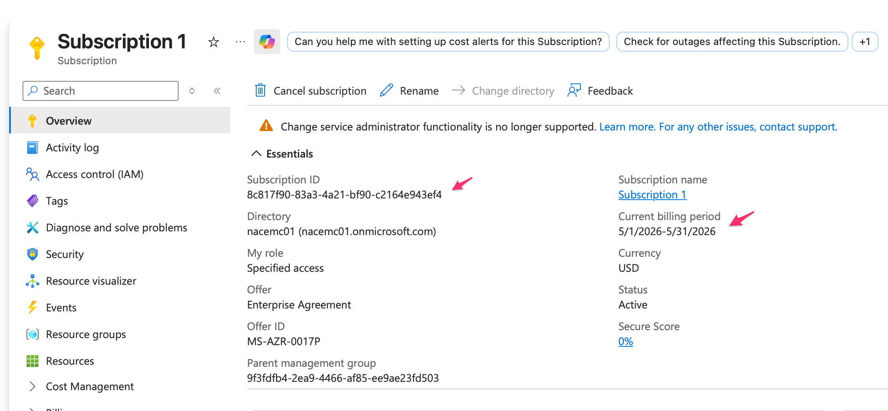
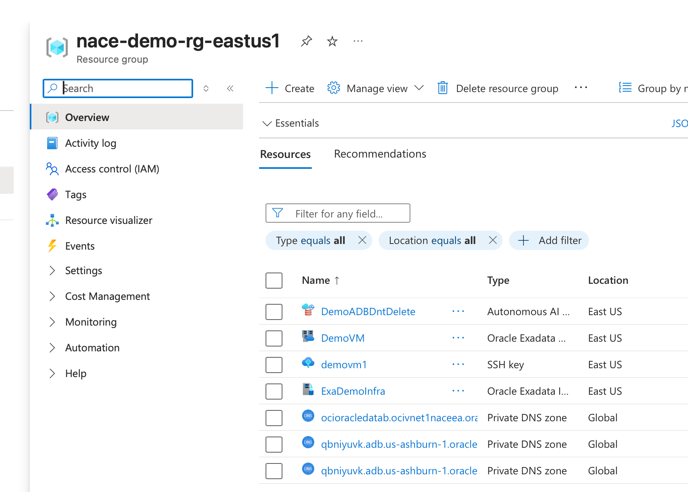
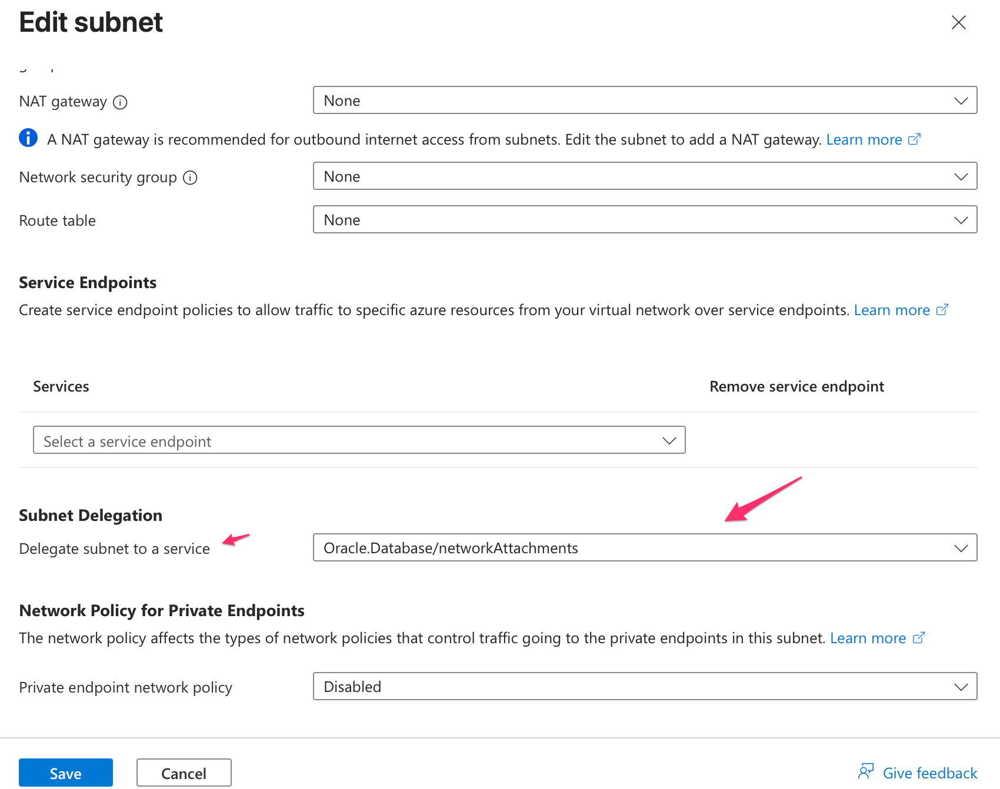

# Inspect Azure subscriptions and networking

## Introduction

Inspect the Azure subscription, resource group, virtual network, and delegated subnet used by the demonstration.

Estimated Time: 20 minutes

### Objectives

* Identify the subscription that is linked to OCI.
* Locate the resource group and VNet used by Oracle database resources.
* Review subnet addressing and delegation.

### Prerequisites

* Complete the introduction and obtain read access to the assigned Azure resources.

## Task 1: Inspect the subscription and resource group

1. In the Azure portal, search for **Subscriptions** and open your assigned subscription.
2. Record the subscription ID in your private environment worksheet. You will compare it with OCI in Lab 4.

    

3. Search for **Resource groups** and open your assigned group, such as `nace-demo-rg-eastus1` in the source demonstration.
4. Review its region, resource list, and your access. Identify Oracle databases, network resources, and any shared infrastructure.

    

## Task 2: Inspect the virtual network and subnet

1. Search for **Virtual networks** or filter the group's resources by virtual network. Open the VNet assigned for this review, such as `vnet1-nace-eastus1`.
2. Review its address space and region. Select **Subnets**, then the assigned Oracle client subnet.
3. Record the subnet's CIDR and inspect its delegation. The source demonstration shows `Oracle.Database/networkAttachments`.

    

4. Identify any displayed route table, network security group, and endpoint settings. Keep the subnet configuration unchanged and cancel any open edit panel.
5. Compare the review VNet with the network selected for each resource in Lab 1. Different services can use different assigned networks; do not assume all screenshots show one VNet.

### Checkpoint

You can identify the subscription ID, resource group, VNet address space, subnet CIDR, and delegation used in your assigned environment.
