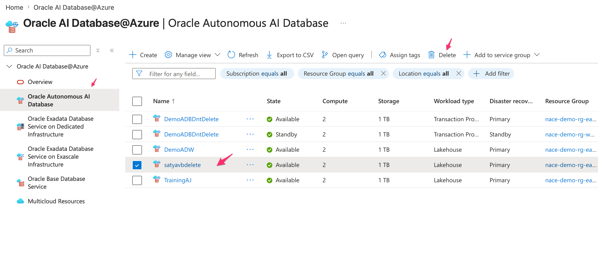

# Clean up resources and review costs

## Introduction

Remove the resources you personally created in Lab 1 and review cost visibility. Keep facilitator-owned databases, networks, infrastructure, and shared storage in place.

Estimated Time: 15 minutes

### Objectives

* Reconcile the resource inventory against the resources created during the workshop.
* Delete learner-owned resources and verify their final state.
* Review cost analysis and existing budgets where access permits.

### Prerequisites

* Retain the Azure resource IDs recorded in Lab 1 and permissions to delete your own resources.
* Identify ownership and dependencies before deleting any resource.

## Task 1: Reconcile your inventory

1. Open your Lab 1 inventory. For each entry, confirm the exact resource ID, name, type, subscription, resource group, and ownership.
2. If you used review mode throughout, record that no resources were created and continue to Task 3.
3. Exclude shared examples such as `DemoADBDntDelete`, `DemoADW`, `DemoVM`, `DemoDb`, `ExaDemoInfra`, and `demogoldengate`. Names are only a cross-check; use recorded resource IDs to identify your own resources.
4. Check for database or storage dependencies on any Exascale VM cluster you created. This workshop does not create an Exascale database inside the cluster. If extra dependencies were added, have the environment owner resolve their cleanup order before deleting the cluster.

## Task 2: Delete your workshop resources

1. In Azure, open each Autonomous database you created. Match its resource ID against your inventory, select **Delete**, review the confirmation, and confirm deletion.

    

2. Repeat for each Base Database resource you created, following the deletion workflow for that resource type.
3. If you created an Exascale VM cluster, verify it has no required databases or other dependencies, then use its Azure deletion workflow. Preserve pre-existing shared storage vaults. Ask the owner to identify any retained learner-owned artifacts before removing them.
4. If you created a GoldenGate deployment, match its resource ID to your inventory and use the deployment deletion action exposed for that resource. Review its dependencies and preserve shared anchors and networks. This workshop creates no replication connections or processes. If you added any independently, resolve their ownership and cleanup with the facilitator first.
5. Track deletion status in Azure and check the corresponding OCI resources in the correct region and compartment. Allow for asynchronous updates. The source estimate of 20 minutes is illustrative, not a completion guarantee.
6. Record a final state for each inventory entry. If deletion fails or a counterpart remains, capture the resource ID and error for the facilitator. Do not mark cleanup complete while a billable learner resource remains unresolved.
7. Delete neither the shared resource group nor shared VNets, subnets, anchors, Exadata infrastructure, or demo databases.

8. If you applied Recovery Service settings in Lab 4, give the owner your change record and verify the required retention and cost handling. Do not disable protection or delete retained backups merely to complete the workshop.

## Task 3: Review cost visibility

1. Open **Cost Management + Billing** or **Cost Management** for your assigned subscription, if permitted, and choose **Cost analysis**.
2. Scope to your resource group and workshop dates. Filter or group by resource where available and identify entries associated with your inventory.
3. Review the displayed forecast and any existing **Budgets**. Do not create or edit budgets during this review task.
4. Record that usage and cost data can appear after the resource action. Check the portal's data freshness before concluding that a deleted resource has no accrued charges.

### Checkpoint

Every resource you created is deleted or has a documented unresolved cleanup issue with its owner. Shared resources remain available, and you can locate the cost-analysis view for your subscription.
