# Review and provision database resources

## Introduction

Review the preprovisioned Autonomous AI Database, Base Database, Exascale VM cluster, and GoldenGate deployment and their creation workflows. Use review mode by default for the environment described in the source script. Provisioning is an optional exercise for an assigned environment with approved permissions, capacity, and configuration.

Estimated Time: 80 minutes

### Objectives

* Configure an Autonomous AI Database using your assigned subscription and private network.
* Identify the distinct settings required by Base Database.
* Distinguish an Exascale VM cluster from a database running within that cluster.
* Inspect GoldenGate deployment configuration and anchors.

### Prerequisites

* Complete the introduction and environment worksheet.
* Obtain creation permissions, quota, license selection, and approved settings for each service you will provision.
* Obtain an SSH public key for Base Database and Exascale. Retain the private key securely.

## Task 1: Open Oracle AI Database@Azure

1. Sign in to the [Azure portal](https://portal.azure.com) using your assigned account.
2. Confirm your directory and subscription. Search for **Oracle AI Database@Azure** and open the service.

    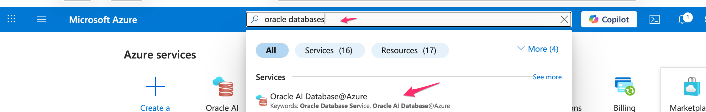

3. Review the service categories. Open each assigned existing Autonomous Database, Base Database, Exascale VM cluster, and GoldenGate deployment, confirm its name and deployment state, and record its resource ID as a shared review resource. Keep these resources out of your learner cleanup inventory.
4. Use the next tasks to inspect the separate creation workflows. In review mode, cancel each form without creating a resource and return to the existing resource overview for the verification steps.

## Task 2: Create an Autonomous AI Database

1. Select **Oracle Autonomous AI Database**, then **Create**.
2. On **Basics**, choose your assigned subscription and resource group. Enter a unique learner-specific name and select your enabled Azure region.

    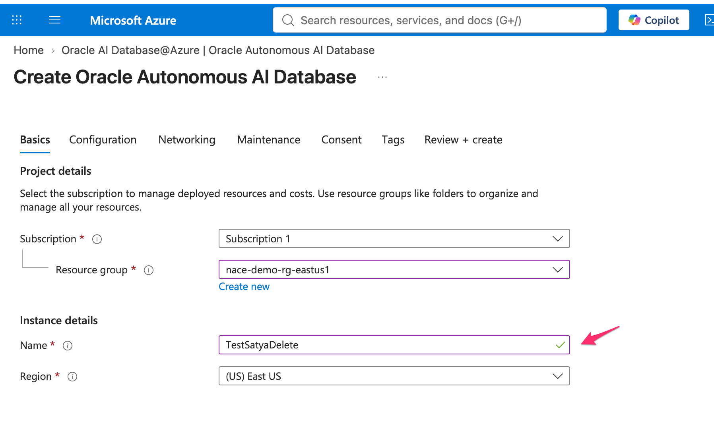

3. On **Configuration**, use the following source-demo settings only where supported by your assigned environment. If a value is unavailable or rejected, use the facilitator-approved value and record the difference.

    | Field | Workshop setting |
    | --- | --- |
    | Workload | Transaction Processing |
    | Database version | 26ai, if available |
    | ECPU count | 2, if supported |
    | Compute auto scaling | Record the facilitator-approved choice |
    | Storage | 30 GB in the source text; confirm the supported minimum and assigned size |
    | Storage auto scaling | Record the facilitator-approved choice |
    | Administrator password | Your unique password, confirmed in both fields |
    | License | Approved license model; BYOL only with entitlement |

    The source screenshots show a different storage allocation from the text. Confirm storage and its unit in the current form before continuing.

4. Review the effect of compute auto scaling: when enabled it permits up to three times the selected ECPUs. Review the storage limits shown in the Azure form separately; do not assume the compute multiplier describes your storage limit.
5. On **Networking**, choose the assigned private access option, VNet, and client subnet. Review any TLS requirements with your facilitator.

    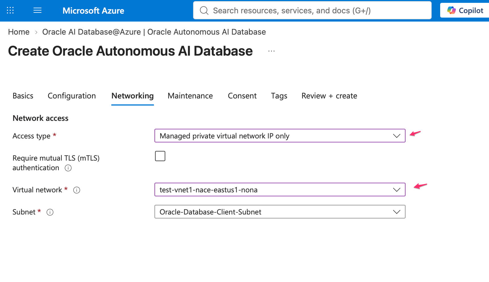

6. Review **Maintenance**, **Consent**, and **Tags**. Use the assigned maintenance policy and required organizational tags. Review service terms before accepting them.
7. Open **Review + create**. Check subscription, region, compute, storage, network, license, and cost implications.
8. In review mode, cancel. In provisioning mode, select **Create**, record the Azure resource ID, and track deployment status. Wait for the resource to become available; the source estimate of 15 minutes is illustrative.
9. Open the resulting database and verify its name, lifecycle state, compute allocation, storage, and network. Add it to your cleanup inventory.

    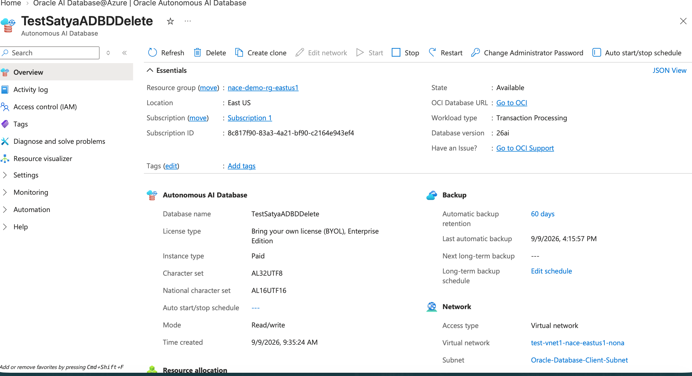

## Task 3: Create a Base Database

1. Return to **Oracle AI Database@Azure**, select **Oracle Base Database Service**, and select **Create**.
2. Supply the assigned subscription, resource group, unique name, region, availability zone, and resource anchor.
3. Review this distinct Base Database configuration. Confirm values against the current portal and your assigned capacity.

    | Field | Source demo or assigned value |
    | --- | --- |
    | Shape | VM.BaseDB.X86, if offered |
    | Database version | Source text: 26.0.0; choose the approved available version |
    | ECPU count | 4, if supported |
    | Edition | Enterprise Edition, subject to entitlement |
    | Available data storage | 256 GB, if supported |
    | SSH public key | Your approved existing Azure key or public key |
    | PDB name | A valid learner-specific name |
    | Administrator password | Your unique password meeting the displayed policy |
    | Resource anchor | Your assigned resource anchor |
    | Network anchor | Your assigned network anchor |
    | Host name | A valid unique learner-specific host name |

    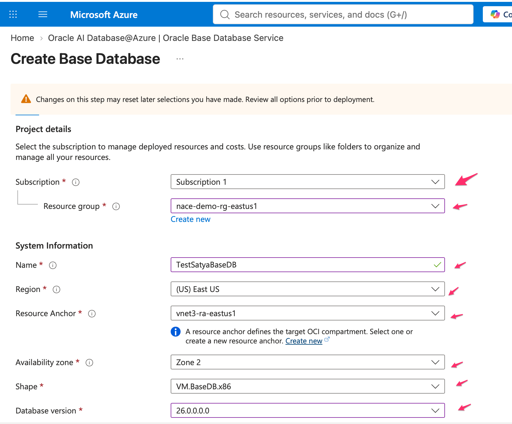

4. Complete **Configuration** and **Networking** using the approved PDB, backup choice, anchors, and subnet. Do not copy Autonomous-specific autoscaling or private-access fields into this workflow.

    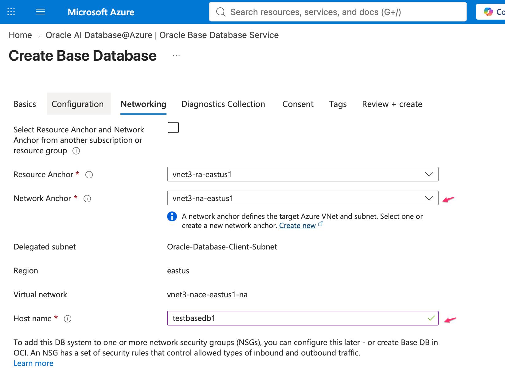

5. Review diagnostics, consent, and tags. At **Review + create**, resolve all validation errors and check the selected compute unit, storage, and license.
6. In review mode, cancel. In provisioning mode, submit the deployment, record its Azure resource ID, and wait for successful completion.
7. Open the Base Database overview and verify the deployment state and assigned networking. Record the resource for cleanup.

## Task 4: Create Exascale

1. Open **Oracle Exadata Database Service on Exascale Infrastructure**, select **VM clusters**, then **Create**.
2. Review **Basics** and enter the assigned subscription, resource group, unique VM cluster name, region, zone, cluster name, license, time zone, Grid Infrastructure release, and SSH public key.
3. Select the assigned storage type and existing storage vault. The source demonstration uses Exascale smart storage. Use an approved available Grid Infrastructure version; do not copy an old patch version from a screenshot.

    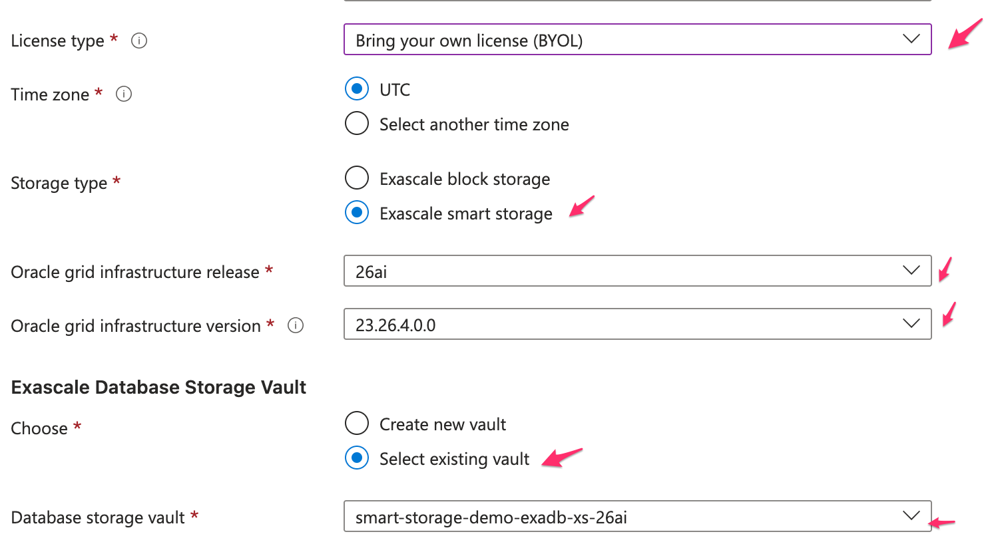

4. On **Configuration**, review the source-demo allocation below with your facilitator. Change values to the approved supported allocation where required.

    | Field | Source demo value |
    | --- | --- |
    | VMs in cluster | 2 |
    | ECPUs per VM | 8 |
    | Total ECPUs | 16 |
    | Memory per VM | 22 GB |
    | Total memory | 44 GB |
    | File system storage per VM | 280 GB |
    | Total file system storage | 560 GB |

    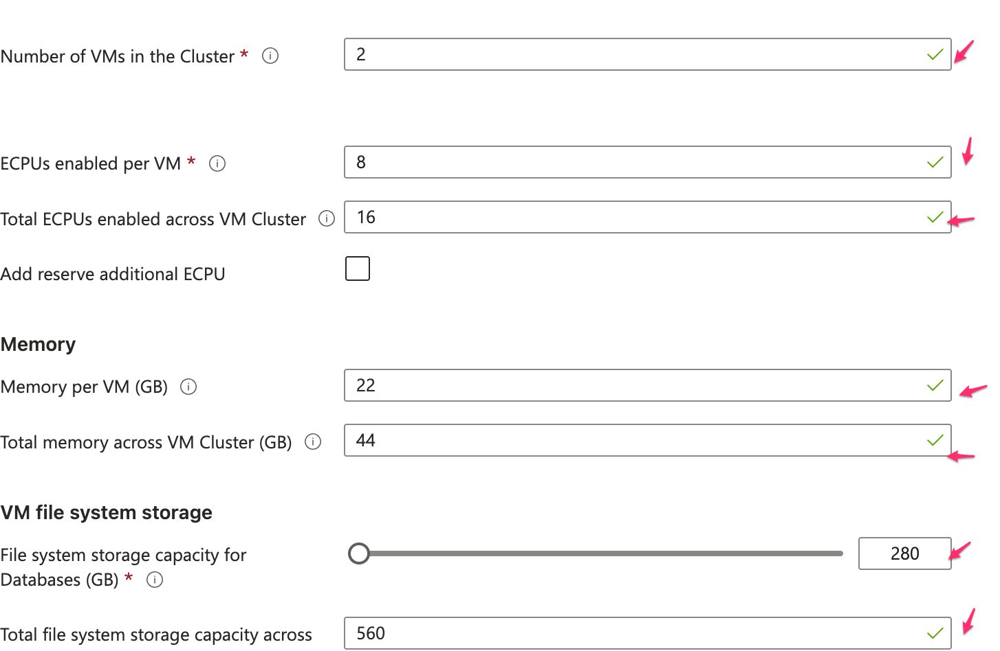

5. On **Networking**, select your assigned VNet and client subnet. Supply a backup subnet CIDR only if required by your approved network plan. Enter your assigned host prefix and review the displayed domain and listener port.
6. Review diagnostics, consent, tags, and the final summary. In review mode, cancel. Submit only when the facilitator has supplied all required settings and confirmed the deployment budget.
7. If you create a cluster, record its Azure resource ID, vault ownership, and deployment state. A completed VM cluster does not mean a database has been created within it.
8. Review the separate [Exascale database workflow](https://docs.oracle.com/en-us/iaas/Content/database-at-azure/azucr-create-exascale-database.html). Database creation within the cluster takes place in OCI and is outside the source demonstration's provisioning steps.

## Task 5: Create GoldenGate

1. In Azure, open **Oracle AI Database@Azure**, select **Oracle GoldenGate**, and open your assigned existing deployment, such as `demogoldengate`. Record its state, anchors, deployment type, and console deployment name.
2. To review the creation workflow, return to **Oracle GoldenGate Deployments** and select **Create**. Use your assigned settings; the following values come from the updated source screenshots.

    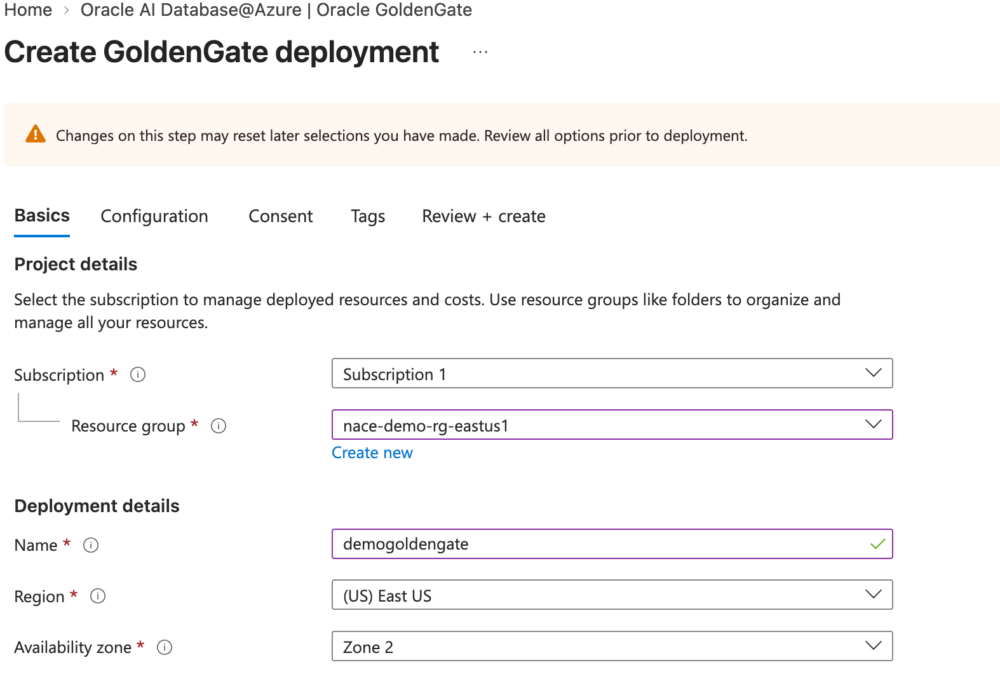

3. Review **Basics** and **Configuration** against this configuration summary.

    | Field | Source demonstration value or learner setting |
    | --- | --- |
    | Subscription and resource group | Your assigned subscription and group |
    | Resource name | demogoldengate in the demo; use a unique name if creating your own |
    | Region and availability zone | East US, Zone 2 in the demo; use the assigned region and zone |
    | Resource anchor | vnet3-ra-eastus1 in the demo |
    | Deployment type | OracleDatabase |
    | Environment type | Development or testing |
    | License | BYOL only with confirmed entitlement |
    | Network anchor | vnet3-na-eastus1 in the demo |
    | Console deployment name | demogg in the demo; use your assigned unique name |
    | Console username | ADMIN in the demo; use the approved account name |
    | Console password | Your unique password meeting the displayed policy |
    | OCPU count | 1 in the demo; confirm supported capacity and cost |
    | Auto scaling | Record the facilitator-approved choice |

    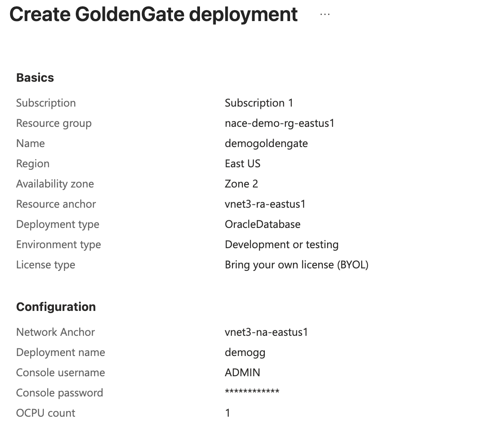

4. Review consent and tags, then open **Review + create**. Check the resource and network anchors, deployment type, license, and compute allocation. Keep console credentials out of the worksheet and workshop files.
5. In review mode, cancel and return to the existing deployment. In optional provisioning mode, submit only with assigned permissions and an approved budget, then record the new resource ID for cleanup. The source estimates 60 minutes for deployment; allow additional time if required.
6. Verify the deployment state and configuration in its overview. Deployment readiness alone does not demonstrate replication: connection creation, connection assignment, and replication configuration are outside this source walkthrough.

    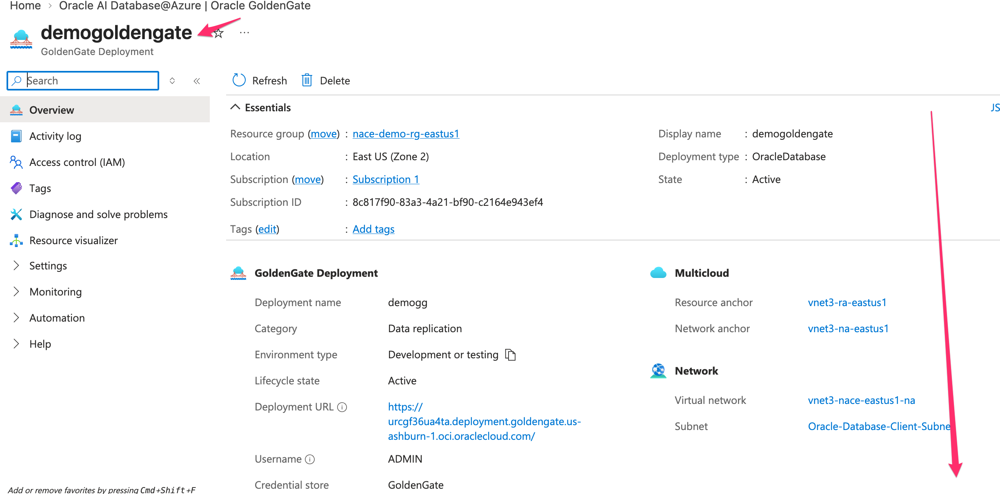

### Checkpoint

Your inventory identifies each resource actually created. You can explain the difference between an Autonomous database, a Base Database system, and an Exascale VM cluster. You can identify GoldenGate deployment settings and distinguish deployment readiness from configured replication. Review-mode learners have canceled all creation forms.

## Learn More

* [Create GoldenGate on Oracle AI Database@Azure](https://docs.oracle.com/en-us/iaas/Content/database-at-azure/azucr-create-goldengate.html)

* [Create an Autonomous AI Database in Azure](https://docs.oracle.com/en-us/iaas/Content/database-at-azure/azucr-create-autonomous-ai-database-serverless.html)
* [Create a Base Database](https://docs.oracle.com/en-us/iaas/Content/database-at-azure/azucr-create-base-database.html)
* [Create an Exascale VM cluster](https://docs.oracle.com/en-us/iaas/Content/database-at-azure/azucr-create-exascale-vm-cluster.html)
