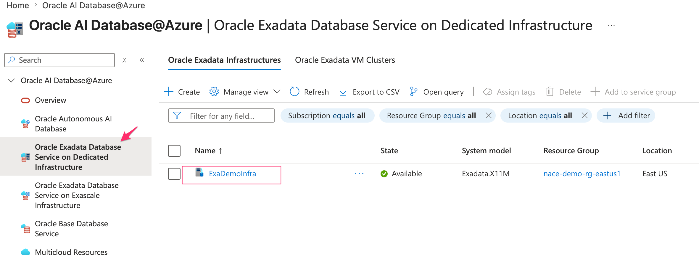
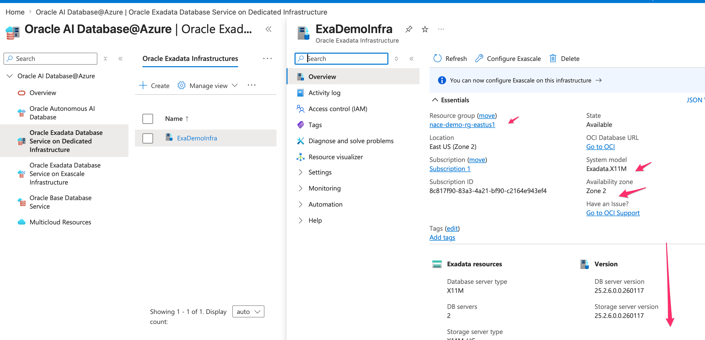
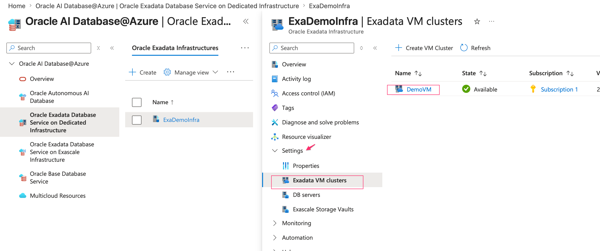
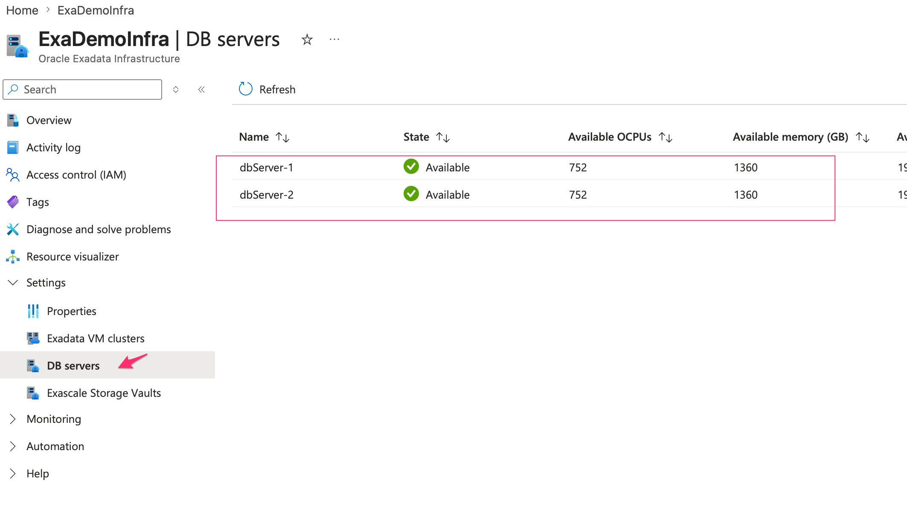

# Inspect Dedicated Exadata Infrastructure

## Introduction

Review preprovisioned dedicated Exadata infrastructure and its relationship to VM clusters and database servers. This lab uses existing resources.

Estimated Time: 20 minutes

### Objectives

* Locate dedicated Exadata infrastructure in Azure.
* Review capacity and availability-zone information.
* Identify the VM cluster and database servers associated with the infrastructure.

### Prerequisites

* Complete the introduction and obtain read access to the facilitator-provided dedicated Exadata environment.
* This lab requires existing dedicated infrastructure; an Exascale VM cluster from Lab 1 does not replace it.

## Task 1: Inspect the infrastructure overview

1. In Azure, open **Oracle AI Database@Azure**, then **Oracle Exadata Database Service on Dedicated Infrastructure**.
2. Open the **Oracle Exadata Infrastructures** list and select your assigned infrastructure, such as `ExaDemoInfra`.

    

3. Record the infrastructure state, region, availability zone, hardware model, and any displayed compute, memory, and storage capacity.
4. Distinguish installed capacity from resources allocated to a VM cluster. Do not assume all infrastructure capacity is assigned to one cluster.

    

## Task 2: Review VM clusters and database servers

1. Under the infrastructure settings, open **Exadata VM clusters** and select the assigned cluster, such as `DemoVM`.
2. Review its status and association with the infrastructure. Record the cluster name for Lab 4.

    

3. Return to the infrastructure and open **DB servers**. The source demonstration has two database servers; inspect the actual count and state in your environment.
4. Review the displayed capacity of each server. Keep all infrastructure and cluster settings unchanged.

    

### Checkpoint

You can trace the relationship between the dedicated Exadata infrastructure, its VM cluster, and its database servers.
