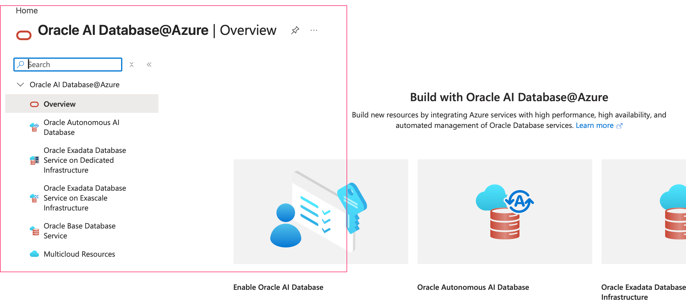
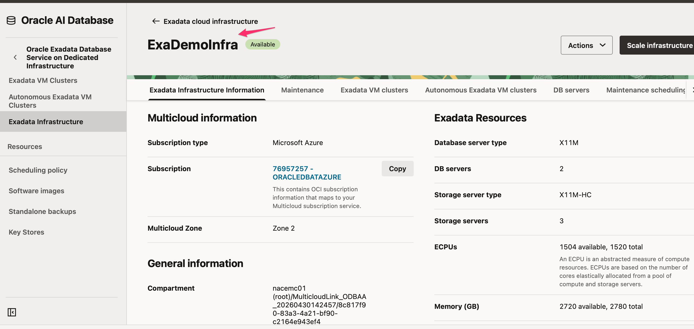

# Oracle AI Database@Azure Enterprise Architecture

## Introduction

Explore how Oracle database services connect Azure resource management with Oracle Cloud Infrastructure (OCI) database operations. This workshop is intended for enterprise architects and technical teams evaluating the deployment and management experience.

Estimated Time: 10 minutes

Estimated Workshop Time: 205 minutes, plus provisioning and deletion wait time

### Oracle AI Database@Azure in the Azure portal

The Azure service overview brings together Autonomous AI Database, dedicated Exadata, Exascale, and Base Database navigation.

### Oracle database management in OCI

The linked OCI view shows Exadata infrastructure, multicloud information, and database resources used in this workshop. Resource names and allocations below belong to the source demonstration.

### Objectives

* Review Autonomous AI Database, Base Database, Exascale, and GoldenGate provisioning workflows.
* Trace Azure subscriptions, virtual networks, and OCI compartments across the linked environment.
* Inspect Exadata infrastructure, VM clusters, backup configuration, and monitoring.
* Remove only the resources you create for this workshop.

### Prerequisites

* An Azure subscription already onboarded to Oracle AI Database@Azure and linked to an OCI tenancy.
* Access to the Azure portal and the linked OCI tenancy using the identity domain or SSO method supplied by your facilitator.
* Permission to view the demo resources. Creation and deletion permissions, available quota, and an approved budget are required for provisioning tasks.
* Existing networks, delegated subnets, resource and network anchors for Base Database, and an Exascale storage vault where applicable.
* Familiarity with cloud networking, identity, and basic database concepts.

## Task 1: Prepare your environment worksheet

1. Obtain the following values from your facilitator. Example names identify the source demonstration; use resources assigned to you. Record environment identifiers privately and keep passwords and private keys out of the worksheet.

    | Setting | Source demonstration example | Your environment |
    | --- | --- | --- |
    | Azure subscription | Subscription1 | Record subscription name and ID |
    | Resource group | nace-demo-rg-eastus1 | Record assigned group |
    | Azure region | East US | Record enabled region |
    | OCI tenancy and identity domain | Facilitator supplied | Record tenancy and sign-in method |
    | OCI compartment | Linked subscription compartment | Record compartment name and OCID |
    | Autonomous database network | test_vnet1-nace-eastus1-nona | Record VNet and client subnet |
    | Base Database anchors | vnet3-ra-eastus1 / vnet3-na-eastus1 | Record approved anchors |
    | Review VNet | vnet1-nace-eastus1 | Record VNet and subnet |
    | Dedicated Exadata infrastructure | ExaDemoInfra | Record assigned infrastructure |
    | Dedicated VM cluster and database | DemoVM / DemoDb | Record assigned resources |
    | Existing Base Database | Facilitator supplied | Record assigned database system |
    | Autonomous review database | DemoADBDntDelete | Record assigned database |
    | Exascale network and vault | Facilitator supplied | Record VNet, subnet, vault, zone |
    | GoldenGate deployment | demogoldengate | Record assigned deployment and console deployment name |
    | GoldenGate anchors | vnet3-ra-eastus1 / vnet3-na-eastus1 | Record assigned resource and network anchors |
    | Recovery Service protection | Bronze, 14-day recovery window | Record database, compartment, and approved policy |

2. Use **review mode** for the preprovisioned environment described in the script. Inspect the assigned resources and creation forms, cancel before submitting, and use the existing resources throughout the workshop. Optional **provisioning mode** is available only when your facilitator has assigned creation permissions, capacity, and a budget.
3. For optional provisioning, use unique learner-specific names, such as `TestAdaAdb` and `TestAdaBaseDb`. Record the full Azure resource ID of each resource you create in a private resource inventory for cleanup. Identify shared resources separately.
4. Review the cost and cleanup guidance. Provisioning uses billable resources. Select BYOL only when your organization has confirmed license entitlement. Use a unique administrator password meeting the portal policy and store it securely outside the worksheet.
5. Treat screenshots as navigation examples. Follow the written steps and assigned settings when a screenshot differs.

## Task 2: Review the workshop route

1. Complete Lab 1 to review the preprovisioned resources and their creation workflows, or optionally provision learner-owned resources. Its Exascale task creates a VM cluster; database creation within that cluster is a separate operation outside this workshop.
2. Complete Labs 2 through 5 to inspect Azure networking, dedicated Exadata, OCI operations, and monitoring. Leave shared demo resources unchanged.
3. Complete Lab 6 to clean up your own resources and check cost visibility.
4. Keep your environment worksheet and resource inventory available throughout the workshop.

### Checkpoint

You can sign in to both portals, identify your assigned resources, and explain which tasks create resources and which inspect existing resources.

## Learn More

* [Oracle AI Database@Azure documentation](https://docs.oracle.com/en-us/iaas/Content/database-at-azure/home.htm)
* [Oracle LiveLabs](https://livelabs.oracle.com)

## Acknowledgements

* **Authors:** Satya Bhamidipati and Padma Priya Rajan Natarajan
* **Last Updated:** October 2026
