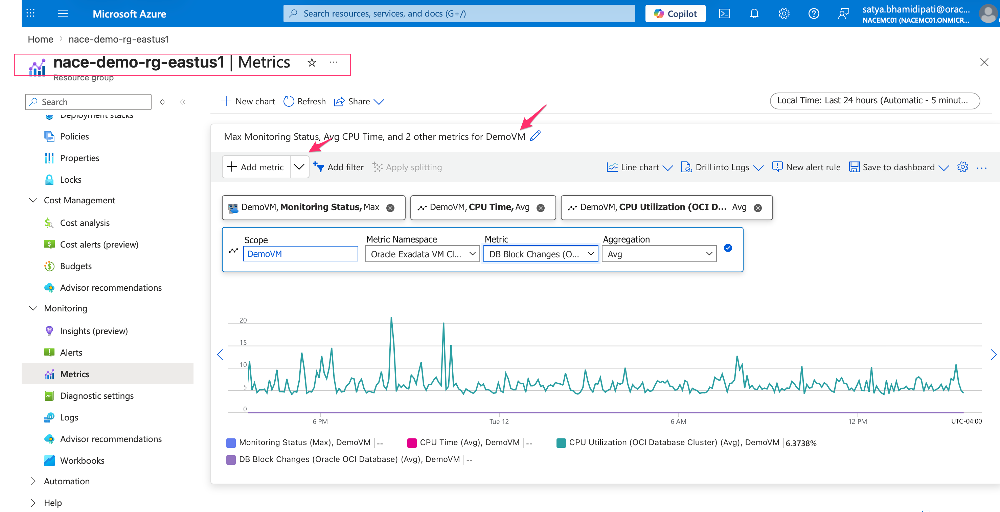
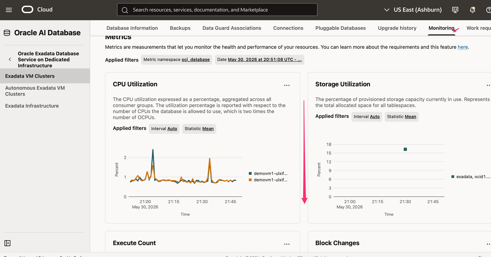

# Review monitoring across Azure and OCI

## Introduction

Compare the monitoring information exposed by Azure with the database metrics available in OCI. Use existing metrics without changing workload or alert configuration.

Estimated Time: 15 minutes

### Objectives

* Locate available Azure metrics for the assigned Oracle resource.
* Inspect health, alerts, and logs where configured.
* Compare a consistent time window across the two portals.

### Prerequisites

* Complete Lab 4 and obtain monitoring read access in Azure and OCI.
* Use a resource with existing activity where possible. Some metrics require prior integration or configuration by the environment owner.

## Task 1: Inspect Azure monitoring

1. In Azure, open the assigned Oracle resource or resource group and select **Monitoring**, then **Metrics**, where offered. You can also use **Azure Monitor > Metrics** and select an available resource scope.
2. Choose an available metric namespace and metric. Record the resource scope, aggregation, time range, and time zone.
3. Inspect the chart and identify a visible peak or a period without activity. An empty chart can indicate no data, an unsuitable time range, an unsupported scope, or missing integration; do not interpret it automatically as healthy operation.

    

4. Inspect existing **Alerts**, **Resource health**, and logs or diagnostic settings where exposed. Record whether each is configured or unavailable in your assigned environment. Do not create alert rules or diagnostic destinations.

## Task 2: Compare with OCI database metrics

1. Open the assigned database in OCI and select **Monitoring**. Use **Performance Hub** or the database performance view if available to your account.
2. Select the same time interval as in Azure, accounting for time-zone differences. Review available CPU, storage, and database activity charts.

    

3. Record one observation from each portal. Compare metric definitions and aggregation before drawing a conclusion; similarly named metrics may measure different things.
4. If data is missing, check the selected resource, region, compartment, time range, permissions, and whether metric collection is configured. Share unresolved observations with your facilitator.

### Checkpoint

You can identify the scope and time interval of a chart, explain a visible trend, and distinguish missing telemetry from a measured zero value.
