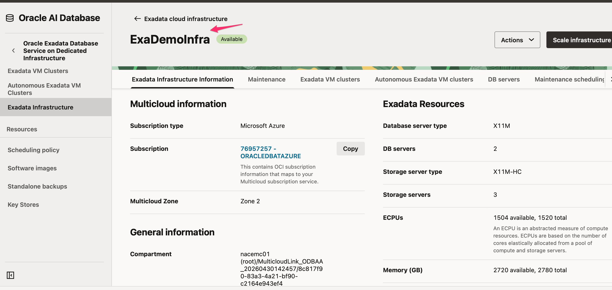
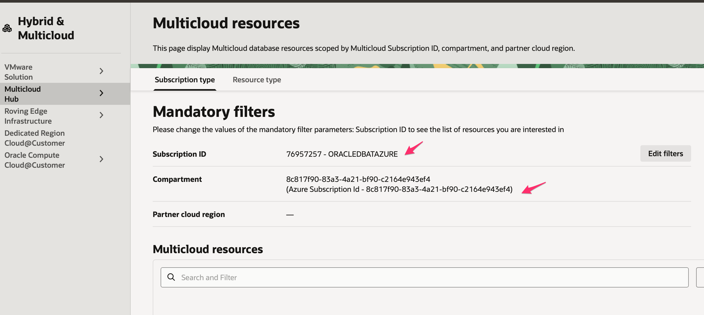
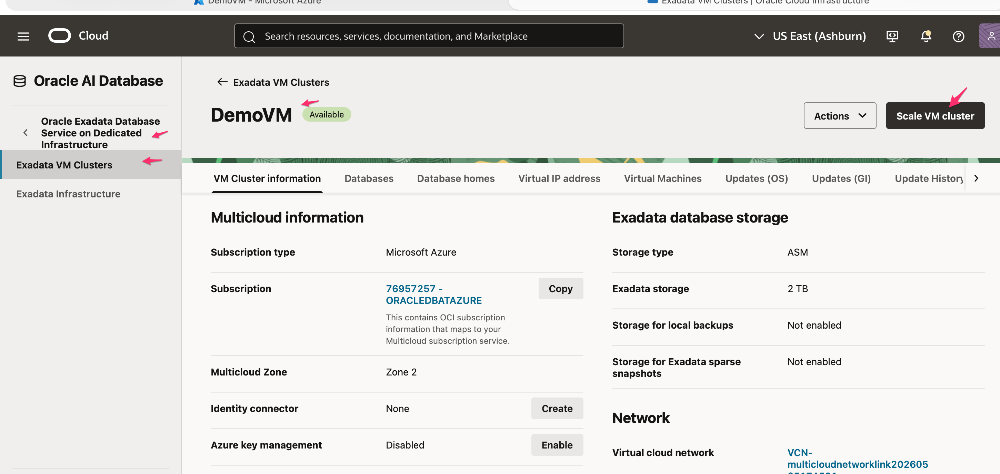
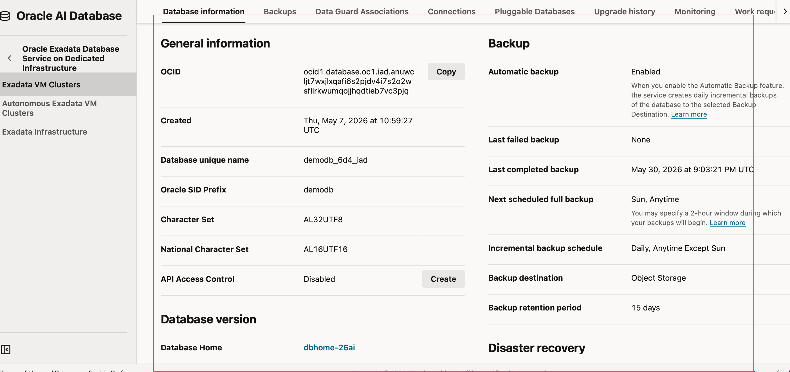
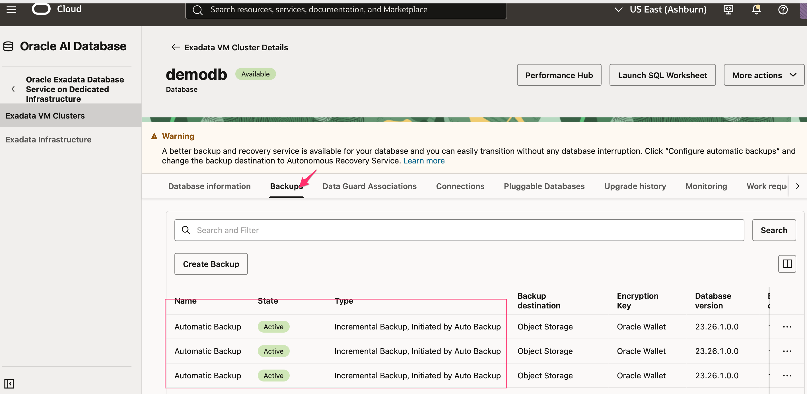
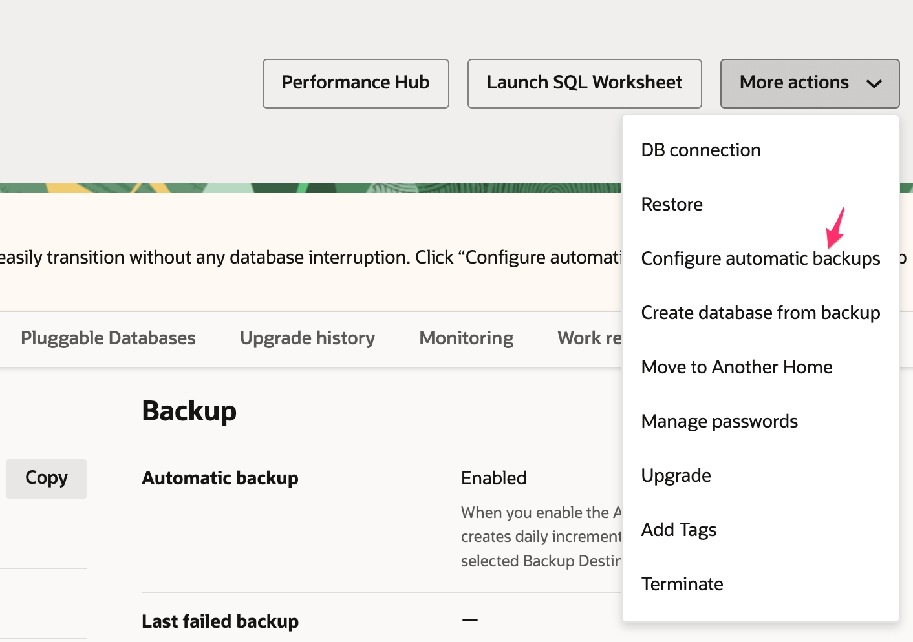
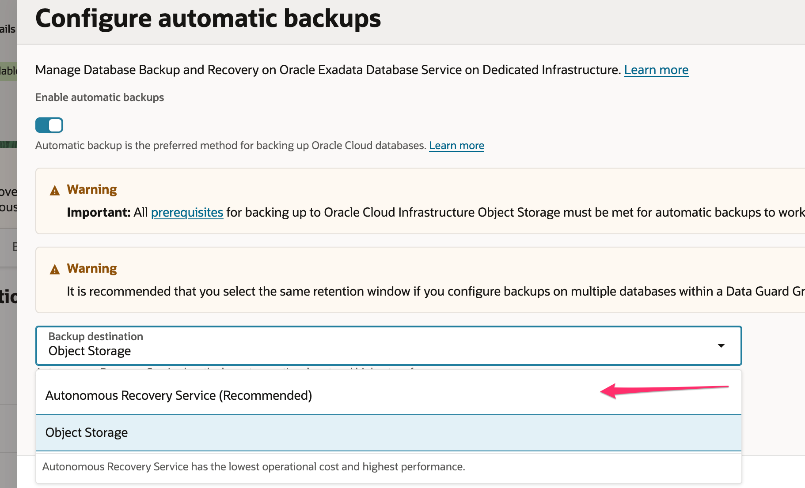
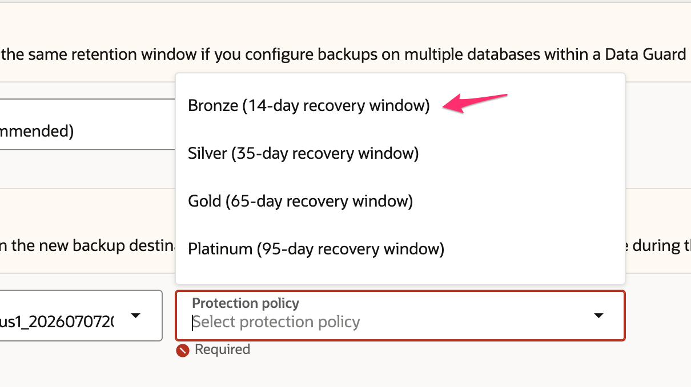
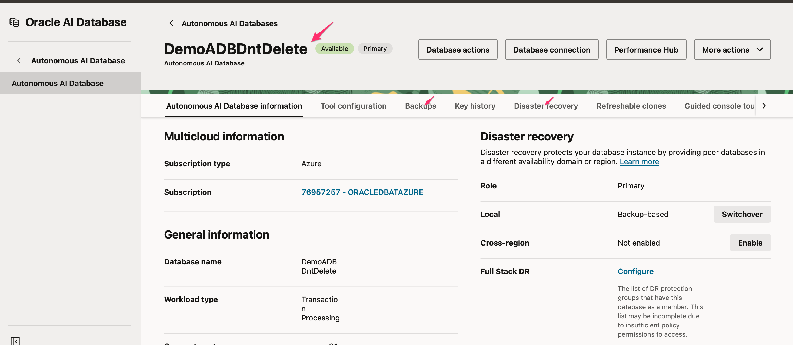

# Inspect OCI management and database operations

## Introduction

Follow the Azure resource link into OCI, inspect the subscription mapping, and review existing cluster and database settings.

Estimated Time: 45 minutes

### Objectives

* Match the Azure subscription to its OCI resource context.
* Inspect cluster allocation, database details, backups, and monitoring.
* Review Autonomous Recovery Service configuration and a 14-day protection policy.
* Review the configured Autonomous database disaster recovery state.

### Prerequisites

* Complete Labs 2 and 3 and retain the subscription ID in your private environment worksheet.
* Obtain access to the linked OCI tenancy, identity domain, compartment, and assigned demo databases.

## Task 1: Follow the resource into OCI

1. In Azure, open the dedicated Exadata infrastructure from Lab 3 and select **Go to OCI**.
2. Sign in using the facilitator-provided tenancy and identity domain or SSO method. Verify that the resulting page refers to your assigned infrastructure.

    

3. Open the OCI navigation menu and locate **Hybrid & Multicloud**, then **Multicloud resources**. Navigation labels may vary.
4. Select the assigned region and compartment filters. Compare the displayed Azure subscription ID with the ID recorded in Lab 2.

    

5. Record the compartment and region for later resource searches. If the subscription or resource does not match, check your tenancy, region, compartment filters, and permissions before continuing.

## Task 2: Inspect the dedicated VM cluster

1. Open **Oracle AI Database**, locate the dedicated Exadata VM clusters, and open your assigned cluster.
2. Review the cluster state, infrastructure link, compute allocation, memory, storage, and network information.

    

3. If your permissions expose **Scale VM cluster**, open the dialog to inspect available controls. Record the current values, then select **Cancel** without applying a change.
4. If the control is unavailable, use the overview values to describe the allocation. Scaling is a review topic in this workshop.

## Task 3: Review database details and backups

1. Open the cluster's **Databases** tab and select the assigned database, such as `DemoDb`.
2. Review the database version, database home, PDB details where shown, and encryption or key-management information.
3. Review the backup configuration and retention policy. Record the destination actually configured; the original source demo uses Object Storage, and the updated script adds Recovery Service configuration in the next task. Verify the actual automatic-backup setting rather than assuming it is enabled.

    

4. Select **Backups**. Check the last backup state, type, and time. If a warning or failed backup is displayed, record it for the facilitator; do not start a backup or change its policy.

    

5. Select **Monitoring** and review the available CPU, storage, and activity charts. Record the selected time interval for comparison in Lab 5.

## Task 4: Review or configure Autonomous Recovery Service

1. Stay on the assigned dedicated Exadata **database** detail page, rather than the Autonomous database page. Review the current automatic-backup setting, destination, and retention policy. Keep shared demo settings unchanged in review mode.
2. Open **More actions > Configure automatic backups**.

    

3. Inspect **Enable automatic backups** and the **Backup destination** list. Select **Autonomous Recovery Service** to review its configuration options.

    

4. Review the required compartment and protection policy. The updated script selects **Bronze (14-day recovery window)**. Confirm that this policy is available and approved for the assigned database.

    

5. In review mode, record the proposed destination and policy, then cancel without saving. For an assigned configuration exercise, first verify the [backup prerequisites](https://docs.oracle.com/en-us/iaas/Content/database-at-azure/azubu-backup-prerequisites.html), including required permissions and networking, with your facilitator. Apply the approved compartment and 14-day policy and save only on the designated exercise database.
6. Reopen the database backup configuration and confirm the saved destination and policy. Check the backup status after scheduling or execution; saving a policy does not establish that a successful backup already exists. Record failures for the facilitator.
7. Record any applied change, the database resource ID, and the original policy for the environment owner. Keep shared policies and protected backups under the owner's retention process.

## Task 5: Inspect Autonomous database configuration and recovery

1. Locate the assigned existing Autonomous database, such as `DemoADBDntDelete`. Confirm that this shared demo database is not in your cleanup inventory.
2. Review the workload, compute, storage, autoscaling settings, and backup configuration displayed in the database overview.
3. Open the disaster recovery section. Record whether local or cross-region protection is configured and identify the displayed peer region when present. If no peer is configured, record that result.

    

4. Explain the distinction between backup recovery and a configured standby. Region labels in the source are examples; verify actual peer configuration in this environment.
5. Leave switchover, failover, restore, scaling, and protection settings unchanged.

### Checkpoint

The subscription IDs match across portals. You can identify the OCI compartment, cluster allocation, backup destination and state, the Recovery Service destination and policy, and the Autonomous database's actual recovery configuration.

## Learn More

* [Exadata automatic backups and Recovery Service](https://docs.oracle.com/en-us/iaas/Content/database-at-azure/azubu-backup-exadata-database-automatic.html)
